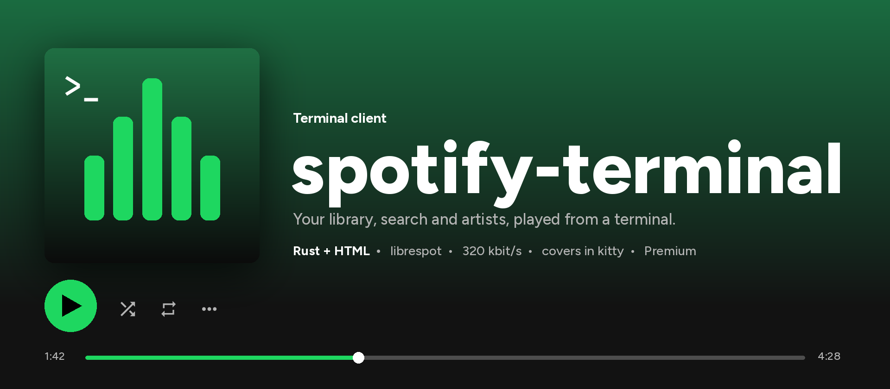
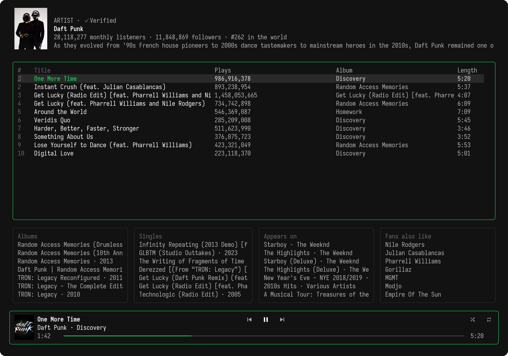
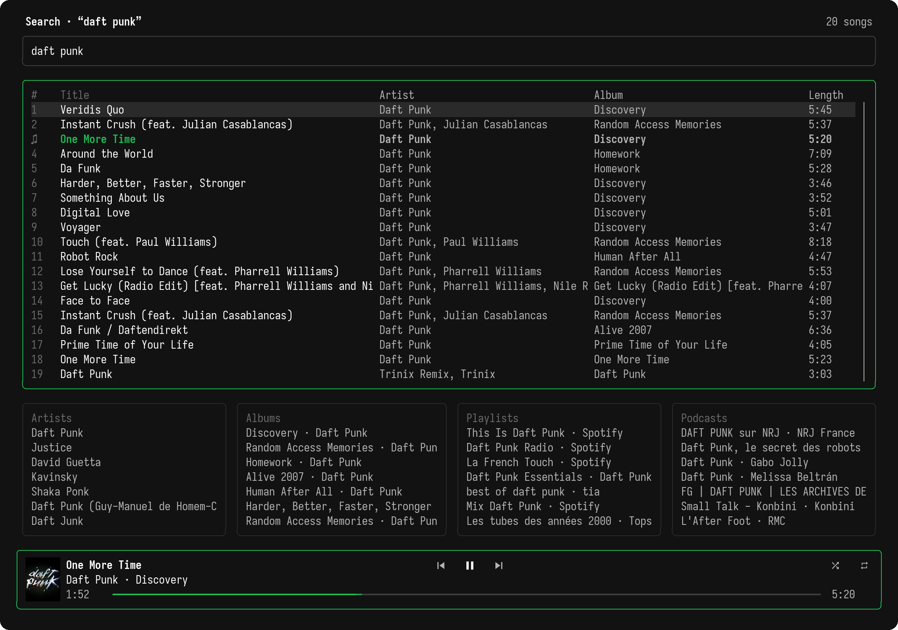
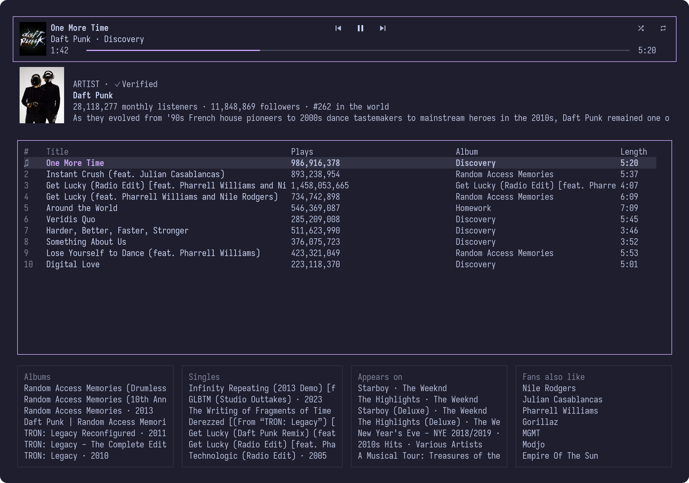
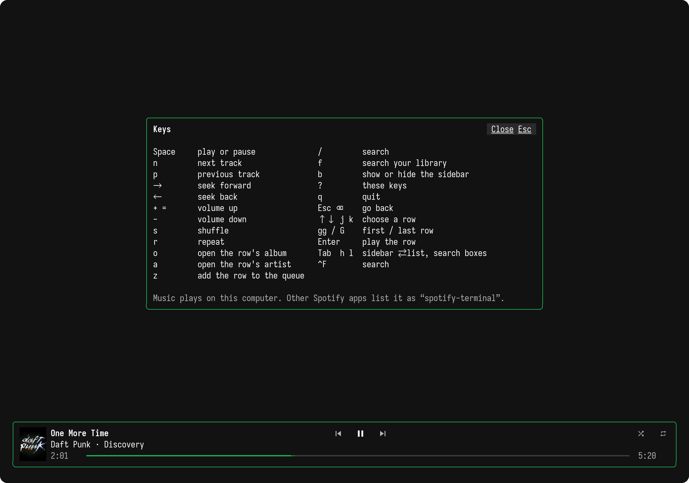
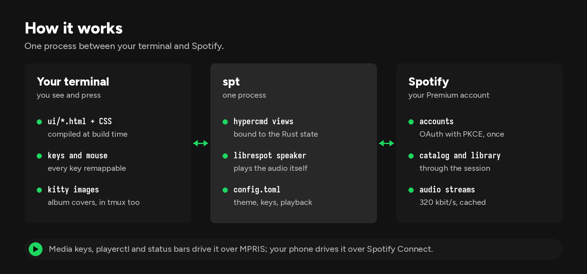

<p align="center">
  
</p>

<p align="center">
  <a href="https://github.com/marc-alexis-com/spotify-terminal/actions/workflows/check.yml"></a>
  <a href="LICENSE"></a>
  
  
</p>

**`spt`** plays Spotify in your terminal. Browse your Liked Songs, playlists and
recent plays, search the catalog, open an artist's page or an album, and listen:
the audio plays on your computer, in 320 kbit/s, with no Spotify app running.
Album covers show in kitty, even inside tmux. Colors, layout, keys and playback
all come from one settings file.

> [!IMPORTANT]
> An **unofficial** client, not affiliated with or endorsed by Spotify. Playback
> needs a **Spotify Premium** account. Spotify's internal services are
> undocumented and can change without notice.

## Features

| Area | What you get |
|---|---|
| **Library** | Liked Songs, playlists in their folders, recently played, and a search of your own library |
| **Catalog** | search as you type, with songs, artists, albums, playlists and podcasts |
| **Artists** | picture, monthly listeners, popular tracks with their play counts, discography, related artists |
| **Playback** | 320 kbit/s, normalised loudness, gapless, seek (30 s in podcasts), volume, shuffle, repeat, queue |
| **Covers** | album and artist pictures in kitty, through tmux too, with Unicode placeholders |
| **Spotify Connect** | other Spotify apps see this computer and can drive it |
| **Media keys** | MPRIS on Linux: `playerctl`, media keys, status bars |
| **Memory** | reopens the view and the row you left |
| **Settings** | theme, corners, player on top or below, sidebar, columns, every key, audio output, cache… |

## A look at it

<p align="center">
  
</p>

<p align="center">
  
  
  <br><sub>A search as you type, and the artist page again with a Catppuccin Mocha theme, square corners and the player on top.</sub>
</p>

<p align="center">
  
  <br><sub><code>?</code> lists the keys, as the settings set them.</sub>
</p>

## Install

**Nix** (flake):

```sh
nix run github:marc-alexis-com/spotify-terminal
nix profile install github:marc-alexis-com/spotify-terminal
```

**Prebuilt binary** (x86-64 or ARM64, Linux or macOS), checked against its SHA-256
before it is installed in `~/.spotify-terminal/bin`:

```sh
curl -fsSL https://raw.githubusercontent.com/marc-alexis-com/spotify-terminal/main/install.sh | sh
export PATH="$HOME/.spotify-terminal/bin:$PATH"
```

Linux binaries need glibc 2.35 or newer, ALSA and OpenSSL 3, as Ubuntu 22.04 has.
`SPOTIFY_TERMINAL_VERSION` picks a release and `SPOTIFY_TERMINAL_INSTALL` another
folder.

**From source**, with a stable Rust toolchain; on Debian or Ubuntu, first
`sudo apt-get install build-essential pkg-config libasound2-dev libssl-dev`:

```sh
cargo install --git https://github.com/marc-alexis-com/spotify-terminal --locked
```

On Linux, the login is kept by a Secret Service provider such as GNOME Keyring,
and `xdg-utils` opens the login page.

## Get started

1. Run `spt` and choose **Log in with Spotify**.
2. Approve access in your browser. The terminal goes on by itself once the
   browser comes back to `http://127.0.0.1:8898/login`.
3. Choose a playlist, select a track and press Enter.

The login stays in the macOS Keychain or the Linux Secret Service, so the next
starts open your library directly; `spt logout` removes it. No Spotify developer
app or client ID is needed.

## Keys

| Key | Action |
| --- | --- |
| `Space` | play or pause |
| `n` / `p` | next / previous track |
| `←` / `→` | seek 10 seconds, 30 in a podcast episode |
| `+` / `-` | volume |
| `s` / `r` | shuffle / cycle repeat |
| `↑` `↓` `j` `k`, `gg` / `G` | choose a row, first / last row |
| `Enter` | play the selected track |
| `o` / `a` | open the track's album / artist |
| `z` | add the track to the queue |
| `/`, `Ctrl+F` / `f` | search the catalog / your library |
| `Tab`, `h` `l` | sidebar, list and search boxes |
| `b` | show or hide the sidebar |
| `Esc` / `Backspace` | go back |
| `?` | show the keys |
| `q` / `Ctrl+C` | quit |

Single keys work outside text fields; the `[keys]` settings change all of them
but the ones that move in the lists.

## Settings

`~/.config/spt/config.toml` (or `$XDG_CONFIG_HOME/spt/config.toml`, or the file
`--config` names) is read at start. The file and each setting are optional; here
is every one with its default:

```toml
[layout]
player = "bottom"       # or "top": the player bar above the library
borders = "rounded"     # or "square"
sidebar = true          # shown at start; b shows or hides it
sidebar_width = 28
results_height = 10     # the boxes below a search or an artist's songs
columns = ["number", "title", "artist", "album", "length"]

[theme]                 # #rrggbb, or "default" for the terminal's own color
background = "#121212"
text = "#FFFFFF"        # titles, the focused row
subtext = "#B3B3B3"     # artists, albums, lengths, the sidebar
muted = "#6A6A6A"       # column headings, notes
unavailable = "#535353" # tracks Spotify cannot play; the border while paused
surface = "#2A2A2A"     # the selected row, borders without the focus
bar = "#3E3E3E"         # the rest of the progress bar, the search field
accent = "#1DB954"      # what plays, what has the focus, what is on
error = "#F15E6C"

[interface]
start = "last"          # or "liked", "recent"
remember_row = true
covers = true           # in terminals that show images
# nerd_font = true      # unset: the SPT_NERD_FONT variable decides
notice_seconds = 4
volume_seconds = 2      # how long the volume bar shows after a change
fps = 60                # of the progress bar while music plays
pause_fade = true       # the player's border fades to gray on pause
bar_glyph = "━"

[playback]
bitrate = 320           # 96, 160 or 320 kbit/s
normalisation = true    # even loudness between tracks
normalisation_type = "auto" # or "album", "track"
normalisation_pregain = 0.0 # dB
gapless = true
autoplay = "account"    # or "on", "off": similar tracks after a list ends
initial_volume = 100    # percent; the system mixer sets the loudness
volume_step = 5         # percent
seek_seconds = 10
podcast_seek_seconds = 30
fade_ms = 150           # around pause and resume; 0 cuts at once
output = ""             # an output from `spt devices`; empty for the system's
device_name = "Spotify" # what other Spotify apps list this computer as
device_type = "computer"

[cache]                 # tracks played before, in ~/.cache/spt/audio
enabled = true
size_mb = 1024

[search]
library_delay_ms = 80   # pause in typing before the search follows it
catalog_delay_ms = 300
results = 8             # in each box
boxes = ["artists", "albums", "playlists", "podcasts"]

[keys]                  # one character, or space, enter, escape, left, right…
play_pause = ["space"]
next = ["n"]
previous = ["p"]
seek_forward = ["right"]
seek_back = ["left"]
volume_up = ["+", "="]
volume_down = ["-"]
shuffle = ["s"]
repeat = ["r"]
open_album = ["o"]
open_artist = ["a"]
queue = ["z"]
search = ["/"]
library_search = ["f"]
toggle_sidebar = ["b"]
help = ["?"]
quit = ["q"]
back = ["escape", "backspace"]
gg_delay_ms = 800       # j, k, h, l, g, G, Enter, Tab and the arrows up and down stay

[system]
mpris = true            # media keys and playerctl, on Linux
reconnect_seconds = 5
browser = "xdg-open"    # opens the login page; "open" on macOS
```

`spt check-config` checks the file without starting, `spt devices` lists the
audio outputs `output` can name. `spt` refuses to start on a mistake in the file
and names the line.

The view and the row you left are kept in `~/.local/state/spt/view.json`, the
device ID beside them, and played tracks in `~/.cache/spt/audio`.

**Home Manager.** The file is plain TOML, so `xdg.configFile` writes it:

```nix
xdg.configFile."spt/config.toml".source = (pkgs.formats.toml { }).generate "spt.toml" {
  layout = { player = "top"; borders = "square"; };
  theme.accent = "#cba6f7";
};
```

## How it works

<p align="center">
  
</p>

- **Browser login.** Spotify's OAuth authorization-code flow with PKCE and a
  local callback on `127.0.0.1:8898`. The refresh token lives in the system
  credential store.
- **Library and catalog** come from Spotify's internal services through a
  [librespot](https://github.com/librespot-org/librespot) session, not from the
  public Web API.
- **Local playback.** An in-process Spotify Connect speaker streams the audio
  through Rodio; its events drive the player bar and MPRIS.
- **HTML views, Rust state.** [Hypercmd](https://github.com/fusor-rs/hypercmd)
  compiles the [HTML templates](ui/) and their CSS at build time and binds them to
  the [Rust state](src/jukebox/). The theme is laid over that stylesheet at start,
  so a new theme needs no new build.

## Troubleshooting

- **No cover.** Covers need kitty, true color, and inside tmux
  `set -g allow-passthrough on`. `interface.covers = false` turns them off.
- **Login lost at every start.** No Secret Service provider runs: start GNOME
  Keyring or another one on the session D-Bus.
- **No sound, or the wrong output.** `spt devices` lists the outputs, and
  `playback.output` picks one.
- **Two players.** A second `spt` registers on MPRIS as `spt.instance<PID>`, and
  Spotify plays on one device of an account at a time.

## Development

Views and styles live in `ui/`, the state in `src/jukebox/`, the settings in
`src/config.rs` and `src/theme.rs`, and Spotify in `src/spotify/`. Dependency
versions are pinned.

```sh
nix develop          # or a Rust toolchain with ALSA and OpenSSL
cargo fmt --all -- --check
cargo clippy --all-targets --locked -- -D warnings
cargo test --locked
```

The README images come from real captures: `docs/images/render.py` draws them
from `tmux capture-pane -e` output, album covers included.

**Releases.** Bump the version in `Cargo.toml` and `Cargo.lock`, then publish a
GitHub release tagged `vVERSION`: the [Release workflow](.github/workflows/release.yml)
checks the tag, builds x86-64 and ARM64 binaries for Linux and macOS, tests each
with [install.sh](install.sh), and attaches them with their checksums.

## Acknowledgements

spotify-terminal began as a fork of [fusor-rs/spotify-tui](https://github.com/fusor-rs/spotify-tui)
by Fusor, and grew from there. It plays through
[librespot](https://github.com/librespot-org/librespot) and draws with
[Hypercmd](https://github.com/fusor-rs/hypercmd) and [Fusor](https://github.com/fusor-rs/fusor).

## Legal

Spotify is a trademark of Spotify AB. This project is not affiliated with,
sponsored or endorsed by Spotify. It needs your own Premium account and plays
only what that account may play.

## License

[MIT](LICENSE).
